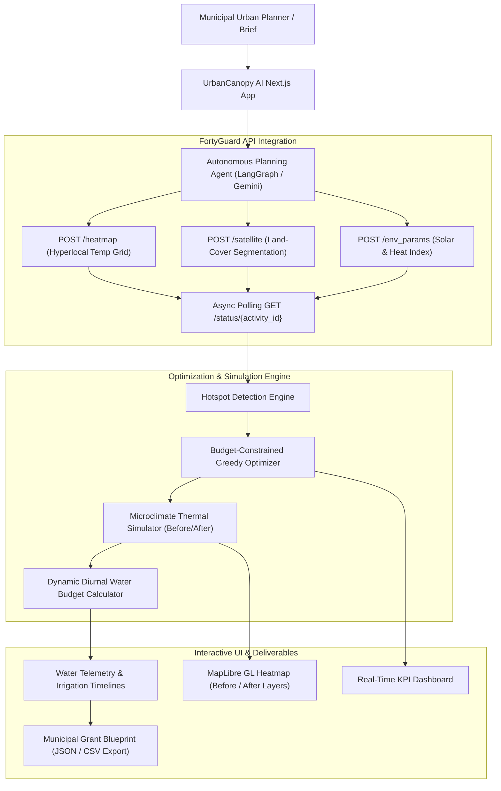

<div align="center">

# 🌳 UrbanCanopy AI
### Autonomous Microclimate Urban-Planning Assistant
**Built for the FortyGuard Hackathon '26**

[](https://nextjs.org/)
[](https://www.typescriptlang.org/)
[](https://www.fortyguard.com/)
[](https://maplibre.org/)
[](https://www.langchain.com/)

<p align="center">
  <em>Transform municipal climate briefs and capital budgets into parcel-level cooling blueprints. Powered by FortyGuard Temperature APIs and autonomous planning agents.</em>
</p>

</div>

---

## 📖 Overview

Urban heat islands (UHIs) cause unshaded pedestrian corridors, transit stops, and school zones to reach dangerous surface temperatures exceeding 115°F+. Municipal urban planners and heat officers often lack the granular, hyperlocal temperature data and simulation tools needed to optimize limited capital improvement budgets.

**UrbanCanopy AI** solves this by:
1. **Auditing Thermal Risk**: Pulling hyperlocal street-level temperature grids and satellite surface segmentation from the **FortyGuard Temperature API**.
2. **Identifying Hotspots**: Pinpointing unshaded asphalt and concrete corridors where pedestrian heat exposure is critical.
3. **Optimizing Interventions**: Formulating an optimal combination of climate-matched tree species (15+ species) and engineered high-albedo shade structures within a strict municipal budget cap ($10K–$2M).
4. **Simulating Microclimate Impact**: Projecting before/after temperature drops across the target area with spatial diminishing-returns modeling.
5. **Dynamic Water Budgeting**: Calculating weather-adaptive diurnal irrigation schedules (pre-dawn 4–6 AM) to conserve water while ensuring plant survival.
6. **Exporting Municipal Blueprints**: Delivering grant-ready blueprints with GIS coordinates (CSV), structured data (JSON), and mapping to federal grant programs (EPA, USDA, HUD, DOE).

---

## 🏛️ System Architecture



---

## 🚀 Key Functional Pillars

### 1. 🌡️ Hyperlocal Thermal Audit
* Ingests FortyGuard `/heatmap` data with tile-by-tile temperature distributions.
* Uses `/satellite` segmentation to differentiate high-absorption asphalt/pavement from vegetative cover.
* Ingests `/env_params` to factor in solar irradiance ($W/m^2$), relative humidity, and precipitation offsets.

### 2. 🌳 Multi-Tier Intervention Catalog
* **15 Climate-Matched Tree Species**: Complete botanical profiles (Desert Willow, Blue Palo Verde, Southern Live Oak, London Plane, Chinese Pistache, Velvet Mesquite, etc.) detailing canopy spread, drought tolerance, base daily water consumption, and unit costs.
* **6 Engineered Shade Structures**: High-albedo tensile sails, fabric awnings, hexagonal gazebos, pyramid transit shelters, and butterfly structures with UV-blocking metrics.
* **Priority Modes**:
  * ⚖️ *Balanced*: Harmonizes cost, shade, and water conservation.
  * 🌡️ *Max Cooling*: Prioritizes absolute temperature drop.
  * 💧 *Low Water*: Maximizes drought-tolerant native species and tensile sails.
  * ⚡ *Fast Shade*: Deploys rapid engineered structures for immediate relief.

### 3. 🧮 Predictive Thermal Simulation
* Inverse-distance weighted thermal overlap model calculating radiant and convective cooling drops.
* Interactive before/after toggle directly on the MapLibre canvas with tile hover tooltips.

### 4. 💧 Dynamic Diurnal Water Budgeting
* Formulates hyper-localized watering recommendations prioritizing pre-dawn windows (4:00 AM – 6:00 AM) to curb evaporative loss by up to 40%.
* Weather-adjusted gallon calculators factoring in solar radiation, temperature multipliers, growth stage, and municipal drought restrictions.

### 5. 📄 Municipal Blueprint & Grant Export
* Full capital expenditure breakdown comparing tree planting vs. shade structure investments.
* Direct mapping to federal funding programs:
  * **EPA Urban Heat Island Reduction Program**
  * **USDA Urban & Community Forestry Program**
  * **HUD Community Development Block Grant (CDBG)**
  * **DOE Office of Energy Efficiency — Building Technologies**
* One-click download of full blueprint in structured JSON and GIS-ready coordinates in CSV format.

---

## 🛠️ Tech Stack

* **Framework**: Next.js 15 (App Router, Server Actions)
* **Language**: TypeScript 5 (Strict Mode)
* **Styling**: Custom CSS Design System (FortyGuard Dark Palette, Glassmorphism, Responsive Grid)
* **GIS & Mapping**: MapLibre GL 5 (Raster Dark Basemap, Vector GeoJSON Fill & Circle Layers)
* **Agentic AI**: LangGraph, Gemini 2.5 Flash, Tool-Calling Pipeline
* **State Management**: Zustand
* **API Client**: Asynchronous Polling Client with Exponential Backoff & Enveloped Response Handling

---

## ⚡ Quickstart Guide

### Prerequisites
* **Node.js**: v18.17+ (v20+ or v22 recommended)
* **npm**: v9+

### 1. Clone the Repository
```bash
git clone https://github.com/paula785/fortyguard_Hackathon.git
cd fortyguard_Hackathon
```

### 2. Install Dependencies
```bash
npm install
```

### 3. Environment Configuration
Create a `.env.local` file in the root directory (or use the pre-configured default):

```env
# FortyGuard Temperature API Key
FORTYGUARD_API_KEY=e983b506118ca77b1a9a6af814000d05
FORTYGUARD_BASE_URL=https://api.fortyguard.com/v1

# Optional: Google Gemini API Key for LangGraph LLM Agent
GOOGLE_GENERATIVE_AI_API_KEY=your_gemini_api_key_here
```

> **Note**: The application includes native fallback execution for the FortyGuard planning pipeline, so it works completely out of the box with the FortyGuard API key alone!

### 4. Run Development Server
```bash
npm run dev
```

Open [http://localhost:3000](http://localhost:3000) in your browser.

---

## 📡 FortyGuard API Endpoints Utilized

| Endpoint | Method | Purpose in UrbanCanopy AI |
| :--- | :--- | :--- |
| `/v1/heatmap` | `POST` | Generates hyperlocal polygon temperature tile distribution |
| `/v1/satellite` | `POST` | Land-cover classification (vegetation, asphalt, buildings) |
| `/v1/env_params` | `POST` | Solar irradiance, heat index, and humidity for irrigation models |
| `/v1/streetview` | `POST` | Micro-scale street canopy verification |
| `/v1/heat_intelligence` | `POST` | Automated spatial heat report generation |
| `/v1/status/{activity_id}` | `GET` | Asynchronous task polling and result retrieval |

---

## 📂 Project Structure

```
├── src/
│   ├── app/
│   │   ├── api/
│   │   │   ├── agent/route.ts       # SSE streaming LangGraph endpoint
│   │   │   └── heatmap/route.ts     # FortyGuard Heatmap proxy route
│   │   ├── globals.css              # Custom design system & variables
│   │   ├── layout.tsx               # Root layout & MapLibre stylesheets
│   │   └── page.tsx                 # 3-Panel Main Dashboard
│   ├── components/
│   │   ├── Chat/AgentChat.tsx       # AI Assistant Chat & SSE streamer
│   │   ├── Dashboard/KPIPanel.tsx   # Real-time animated KPI panel
│   │   ├── Irrigation/WaterDashboard.tsx # Diurnal water budgeting
│   │   ├── Map/HeatMap.tsx          # MapLibre GL Interactive Map
│   │   └── Report/BlueprintExport.tsx # Grant blueprint exporter
│   ├── lib/
│   │   ├── agent/                   # LangGraph graph, tools & prompts
│   │   ├── catalog/                 # Tree & Shade catalog, greedy optimizer
│   │   ├── irrigation/              # Water budget & schedule calculators
│   │   ├── simulation/              # Thermal simulation & hotspot discovery
│   │   ├── fortyguard-client.ts     # FortyGuard asynchronous API client
│   │   └── fortyguard-types.ts      # TypeScript interfaces
│   └── store/
│       └── app-store.ts             # Global Zustand application state
├── .env.example
├── next.config.ts
├── package.json
└── tsconfig.json
```

---

## 👥 Authors & Acknowledgments

* **Project**: UrbanCanopy AI
* **Hackathon**: [FortyGuard Hackathon '26](https://www.fortyguard.com/hackathon26)
* **APIs**: Powered by [FortyGuard Temperature API](https://docs-api.fortyguard.com/)

---

<div align="center">
  <sub>Built with ❤️ for greener, cooler, and climate-resilient cities.</sub>
</div>
